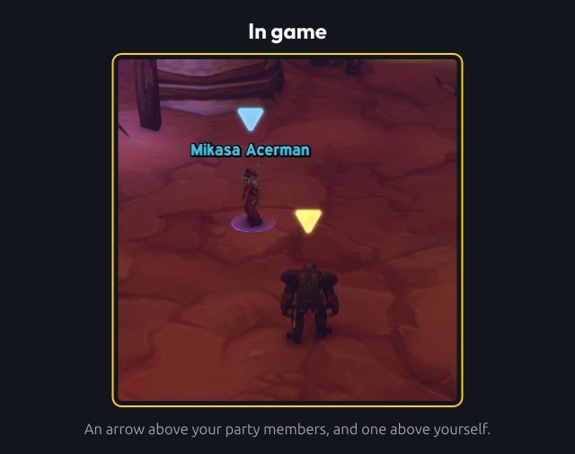
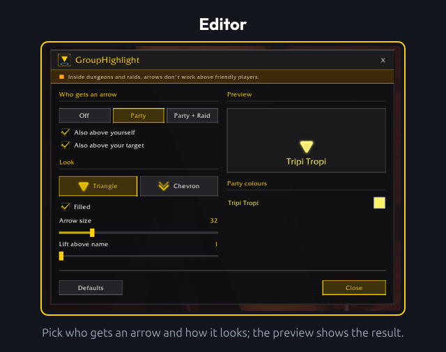
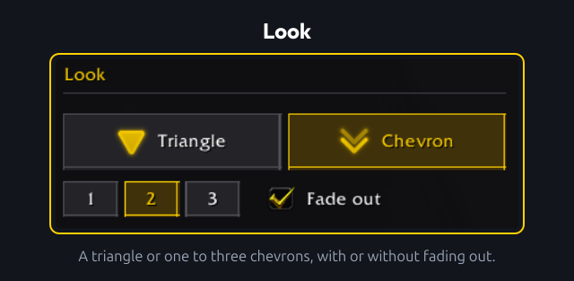
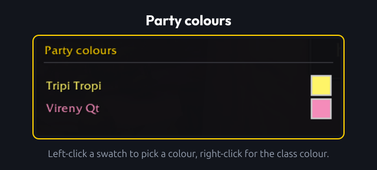
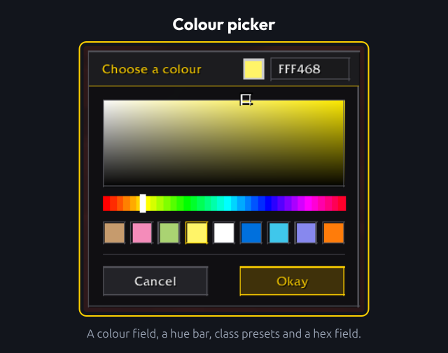

# GroupHighlight

Put an arrow above your party and raid members, so you can find them in a crowd. One arrow per player, in their class colour or a colour you pick.

## Usage

### Editor

- `/gh` or `/grouphighlight`: open the editor. Type it again (or press Esc) to close it.
- Drag the title bar to move the window. Everything you change shows up in the game world immediately, and the position of the window is kept.
- **Who gets an arrow**: Off, Party (everyone in your party except yourself) or Party + Raid. **Also above yourself** and **Also above your target** are separate options.
- **Arrow above yourself**: while the editor is open, drag the arrow above your character to move it. Right-click it to put it back.
- **Defaults**: back to the default options.

### Look

- A triangle (filled or outline) or one, two or three chevrons (with or without fading out).
- **Arrow size** and **Lift above name** set how big the arrow is and how high it sits. The preview shows the result.

### Party colours

- Arrows use the class colour by default.
- Left-click a swatch to open the colour picker for that player, right-click to go back to the class colour.
- A chosen colour is remembered by name and realm.

### Colour picker

- The picker is fixed to the editor and moves with it.
- It has a colour field, a hue bar, a preset for every class and a hex field. The result shows in the game immediately.
- **Okay** keeps the colour, **Cancel** or Esc puts the old one back.
- Choosing exactly the class colour stores nothing, so the player keeps following their class.

### Key binding

- Settings > Keybindings > AddOns > GroupHighlight has **Turn the arrows on or off**. Bind a key to it yourself.
- Pressing it sets the mode to Off. Pressing it again brings back the mode you had before, for example Party + Raid, and not the default mode. The other options stay as they are.

### Settings panel

- Settings > AddOns > GroupHighlight has a button that opens the editor.

### Limitations

- **Arrows need nameplates.** An arrow only appears above a unit that has a visible nameplate. Units without one (objects, units out of nameplate range or out of view) get no arrow.
- **Friendly nameplates.** Only the party and raid modes change nameplate settings: while one is active, the `nameplateShowFriends`, `nameplateShowFriendlyPlayers` and `nameplateShowAll` CVars are turned on, and your previous values are restored when you select Off. CVar changes wait until combat ends.
- **Dungeons and raids.** The game blocks addons from friendly nameplates there, so arrows above other players cannot be shown. Raid markers are no alternative: placing them is a protected action that addons are not allowed to do.
- **Your target.** Works for players and enemies, and for friendly NPCs when you have friendly NPC nameplates turned on in the game's nameplate settings. The target option never changes your nameplate settings, and its tooltip shows which case applies.
- **Yourself.** You have no nameplate, and addons cannot read the screen position of a character, so the arrow above yourself sits at the screen centre and scales with the camera zoom. Drag it to the right place in the editor.

## Development

Please see [CONTRIBUTING](CONTRIBUTING.md) for development checks and contribution guidance.

## Feedback

Please remember that I'm always working to improve the addon, so I'm interested in hearing directly from you about anything you want to share or ask. You can report this using the issues on GitHub.
When reporting bugs or unexpected behavior, include your addon version and an overview of your current options.

## Changelog

Please see the [CHANGELOG](CHANGELOG.md) for more information about recent changes.

## License

This project is open-sourced software licensed under the [MIT license](https://opensource.org/licenses/MIT).

## Support me

If you find my work valuable or just want to show your appreciation, you can buy me a coffee!

