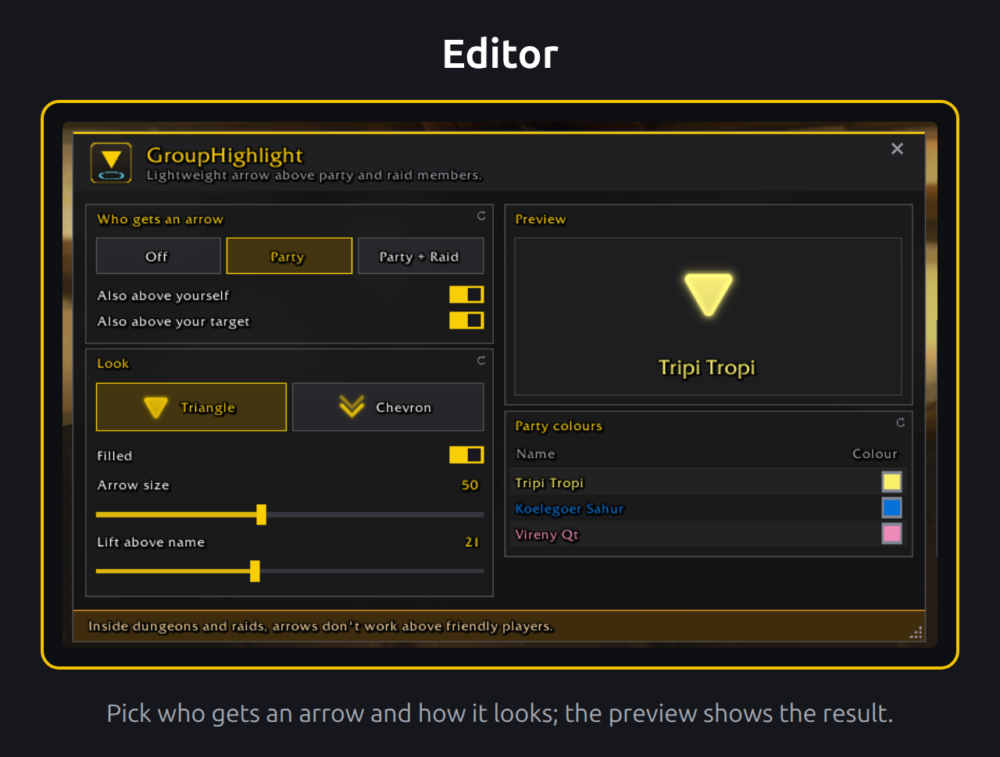
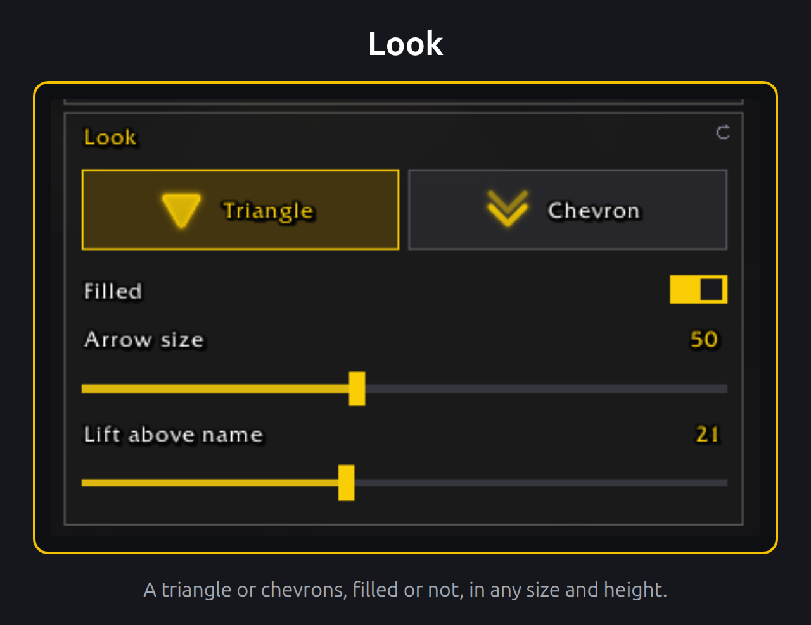
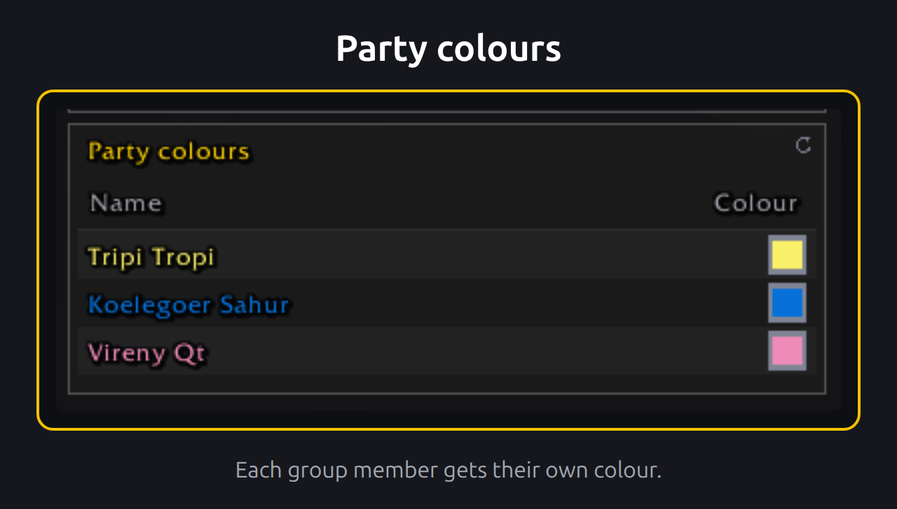
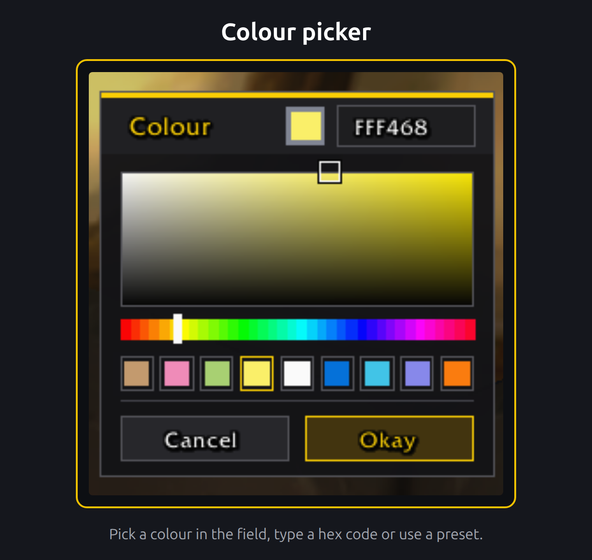

# GroupHighlight

Put an arrow above your party and raid members, so you can find them in a crowd. One arrow per player, in their class colour or a colour you pick.

<!-- release:start -->
  
<!-- release:end -->

## Usage

### Editor

- `/gh` or `/grouphighlight`: open the editor. Type it again (or press Esc) to close it.
- Drag the header band (with the logo and the name) to move the window. Everything you change shows up in the game world immediately, and the position of the window is kept.
- The editor has four boxes: **Who gets an arrow**, **Look**, **Preview** and **Members**. Hover over any option for a tooltip.
- **Who gets an arrow**: Off, Party (everyone in your party except yourself) or Party + Raid. **Also above yourself** and **Also above your target** are separate switches.
- **Reset**: the boxes Who gets an arrow, Look and Members have a small reset icon next to their title that puts only that box back to its defaults. Click it twice: the first click shows **Click again** in red for three seconds.
- The amber band at the bottom says that arrows don't work above friendly players inside dungeons and raids.
- Close the window with the cross in the header band.

### Window size

- Drag the grip in the bottom right corner to change the width and height of the window (it can't be made wider than the default). The size is kept.
- Wide, the boxes sit in two columns; narrow, in one column. When the boxes don't fit, a thin scroll bar appears.
- Right-click the grip to go back to the default size.

### Look

- Pick a shape from the dropdown: a triangle, one, two or three chevrons (with or without fading out), a diamond, a circle, a star, a map pin, a shield, a sword or a plus. The triangle, diamond, circle, star, shield, sword and plus can be filled or an outline (an outline circle is a ring); the pin is solid or has a round hole.
- **Shape size** and **Lift above name** set how big the shape is and how high it sits. The preview shows the result.

### Members

- Arrows use the class colour by default.
- The table lists your party (in a raid: everyone in the raid), with yourself only when **Also above yourself** is on. With more than five names it scrolls.
- Left-click a swatch to open the colour picker for that player, right-click to go back to the class colour.
- The Look column gives a player their own shape: left-click to open the shape picker, right-click to go back to the shape from Look.
- A chosen colour or shape is remembered by name and realm.

### Colour picker

- The picker is fixed to the editor, next to it at the height of the Members table, and moves with it.
- It has a colour field, a hue bar and a preset for every class. The hex code and the new colour (on the far right) are in its title bar; type six hex digits in the hex field, for example FF8800. The result shows in the game immediately.
- **Okay** keeps the colour, **Cancel** or Esc puts the old one back.
- Choosing exactly the class colour stores nothing, so the player keeps following their class.

### Shape picker

- Opens next to the editor, in the same place as the colour picker (only one of the two is open at a time).
- The same dropdown, options, **Shape size** and **Lift above name** as Look. The result shows in the preview and in the game immediately.
- **Okay** keeps the shape, **Cancel** or Esc puts the old one back. Choosing exactly the look from Look stores nothing, so the player keeps following Look.

### Key binding

- Settings > Keybindings > AddOns > GroupHighlight has **Turn the arrows on or off**. Bind a key to it yourself.
- Pressing it sets the mode to Off. Pressing it again brings back the mode you had before, for example Party + Raid, and not the default mode. The other options stay as they are.
- Each press shows the new mode in a toast at the top of the screen, for example "Highlight: Off.". Click a toast to close it.

### Settings panel

- Settings > AddOns > GroupHighlight has an **Open GroupHighlight** button that opens the editor (or type `/gh`).

### Limitations

- **Arrows need nameplates.** An arrow only appears above a unit that has a visible nameplate. Units without one (objects, units out of nameplate range or out of view) get no arrow.
- **Friendly nameplates.** Only the party and raid modes change nameplate settings: while one is active, the `nameplateShowFriends`, `nameplateShowFriendlyPlayers` and `nameplateShowAll` CVars are turned on, and your previous values are restored when you select Off. CVar changes wait until combat ends.
- **Dungeons and raids.** The game blocks addons from friendly nameplates there, so arrows above other players cannot be shown. Friendly nameplates are therefore not turned on inside dungeons, raids and scenarios: your own setting comes back on entering and the addon's again on leaving. Raid markers are no alternative: placing them is a protected action that addons are not allowed to do.
- **Your target.** Works for players and enemies, and for friendly NPCs when you have friendly NPC nameplates turned on in the game's nameplate settings. The target option never changes your nameplate settings, and its tooltip shows which case applies.
- **Yourself.** You have no nameplate, and addons cannot read the screen position of a character, so the arrow above yourself sits at a fixed spot above the screen centre and scales with the camera zoom.

## Development

Please see [CONTRIBUTING](CONTRIBUTING.md) for development checks and contribution guidance.

## Feedback

Please remember that I'm always working to improve the addon, so I'm interested in hearing directly from you about anything you want to share or ask. You can report this using the issues on GitHub.
When reporting bugs or unexpected behavior, include your addon version and an overview of your current options.

## Changelog

Please see the [CHANGELOG](CHANGELOG.md) for more information about recent changes.

## License

This project is open-sourced software licensed under the [MIT license](https://opensource.org/licenses/MIT).

## Support me

If you find my work valuable or just want to show your appreciation, you can buy me a coffee!

